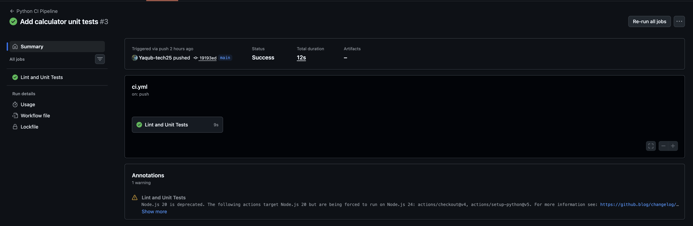

# Automated CI Pipeline with GitHub Actions

## Overview

Built an automated Continuous Integration (CI) pipeline using GitHub Actions to run code quality checks and unit tests whenever changes are pushed to the repository or a pull request is opened against the main branch.

## Technologies Used

- GitHub Actions
- Python 3.12
- Pytest
- Ruff

## Project Structure

```text
Assignment-01-CI/
├── app/
│   ├── __init__.py
│   └── calculator.py
├── tests/
│   └── test_calculator.py
└── requirements-dev.txt
```

The workflow configuration is located at `.github/workflows/ci.yml` in the repository root.

## Pipeline Workflow

The GitHub Actions workflow performs the following steps:

1. Triggers automatically on pushes and pull requests targeting the main branch.
2. Checks out the repository.
3. Sets up Python 3.12.
4. Installs the required dependencies.
5. Runs Ruff to identify code quality issues.
6. Runs Pytest to execute automated unit tests.

## Testing

Two unit tests were implemented to verify the calculator application's addition and subtraction functions.

The pipeline was successfully executed through GitHub Actions, with both linting and unit testing passing after the issues in [Troubleshooting](#troubleshooting) were resolved.

## Screenshots and Evidence

The application code, tests, and workflow configuration are available in this repository, so screenshots of those files and the project tree are unnecessary. Screenshots are for run evidence only. They are not included yet; capture the following three and save them in `Assignment-01-CI/screenshots/` (create the directory if needed), then commit them to Git.

| Filename | Evidence to capture | Status |
|---|---|---|
| `05-local-validation.png` | Successful local Ruff and Pytest output | To capture |
| `06-github-actions-failure.png` | The failed GitHub Actions run showing the Pytest exit code 5 | To capture |
| `07-github-actions-success.png` | The successful GitHub Actions run with linting and tests passing | To capture |

Keep the listed two-digit filenames and use PNG format. Capture enough of each terminal or workflow result to make the command, status, and relevant output readable. Avoid including unrelated browser tabs or personal information. The earlier workflow trigger issue is documented in [Troubleshooting](#troubleshooting); it does not need a separate screenshot.

Once added, link images from this README using paths relative to this file, for example:

```markdown

```

## Troubleshooting

| Issue | Cause | Resolution |
|---|---|---|
| GitHub Actions reported `No event triggers defined in on` | The workflow's `on` key was not quoted, and the YAML parser interpreted it in a way that prevented GitHub Actions from recognizing the configured events. | Quote the key as `"on"` in `.github/workflows/ci.yml`, save the workflow, and rerun it. |
| Pytest exited with code 5 | The test file had not been saved, so Pytest collected no tests. | Save `Assignment-01-CI/tests/test_calculator.py`, rerun the workflow, and confirm the tests pass. The workflow subsequently passed. |
| Node.js 20 deprecation notice for `actions/checkout@v4` and `actions/setup-python@v5` | GitHub Actions warned that these action versions target Node.js 20 and were being forced to run on Node.js 24. | This was a deprecation warning, not the cause of the failed run. The failure was Pytest exit code 5; after saving the test file and rerunning, the workflow passed. |

## Key Learning Outcomes

- Configuring automated CI workflows using GitHub Actions.
- Understanding workflow triggers and job execution.
- Integrating automated linting and unit testing.
- Using GitHub Actions to validate code changes before merging.
- Troubleshooting workflow configuration and test failures.
